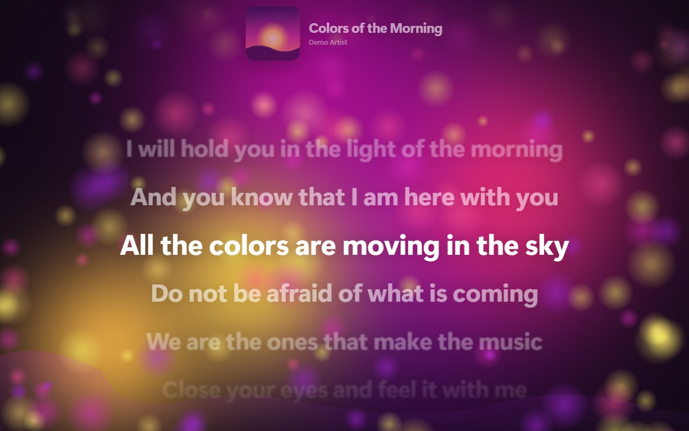
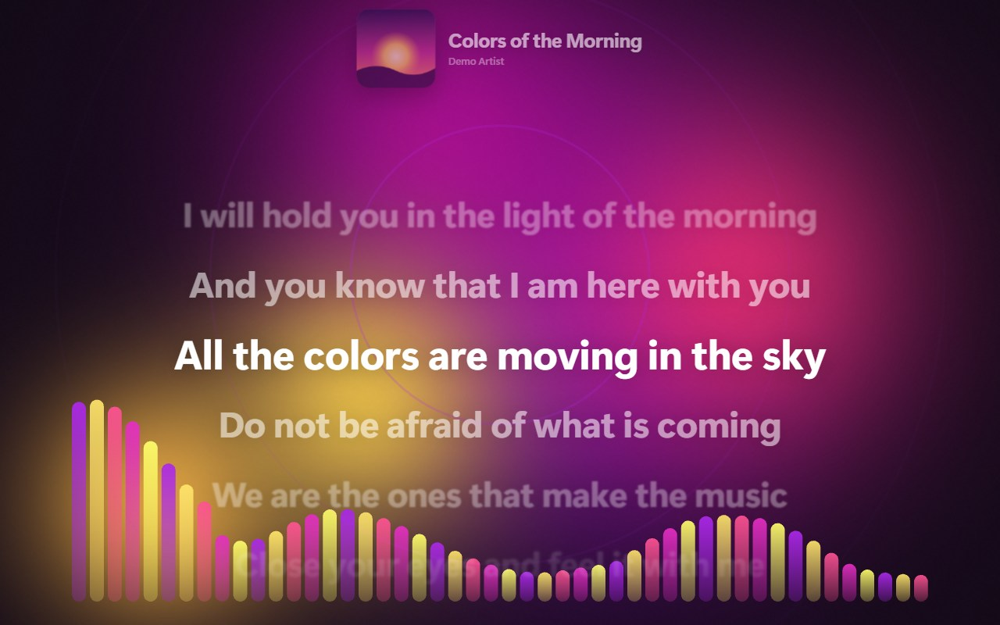
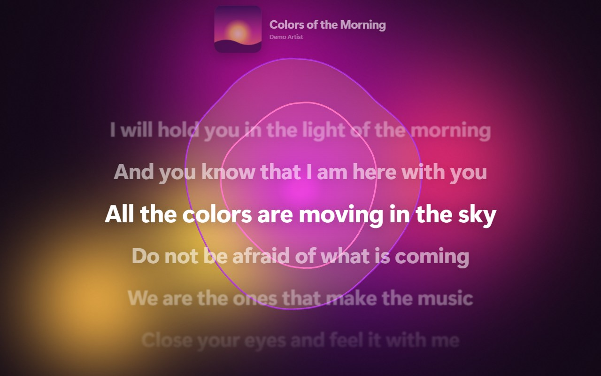
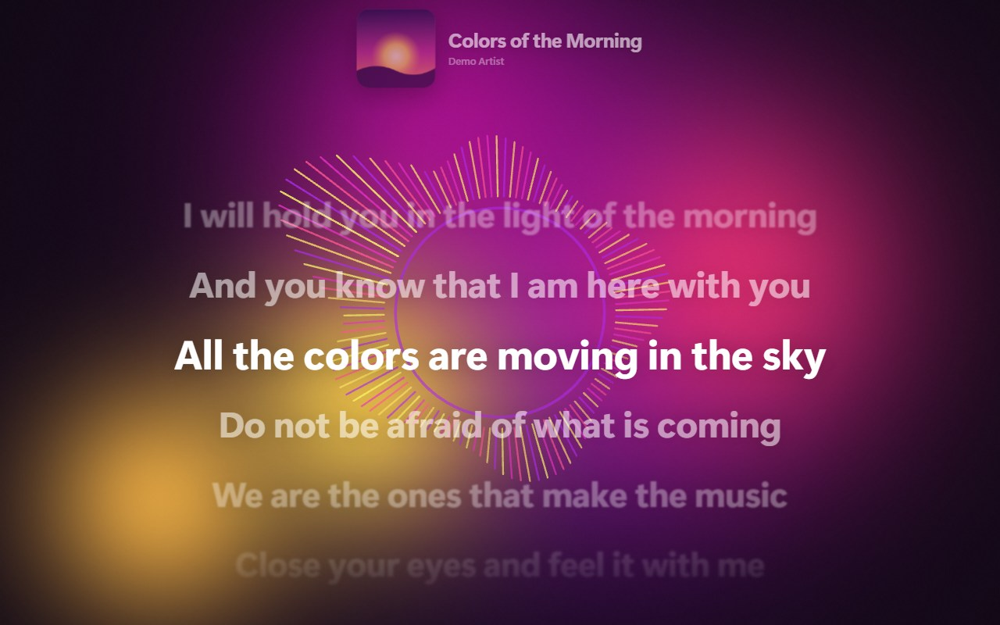
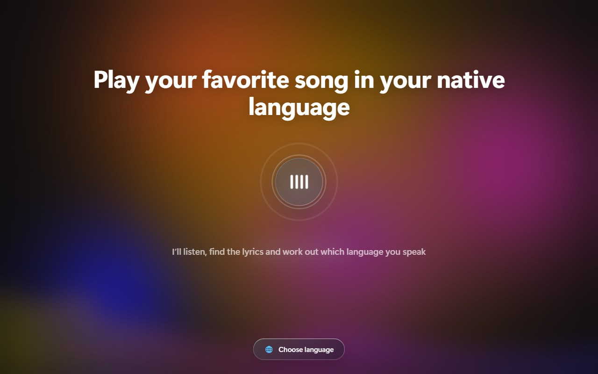
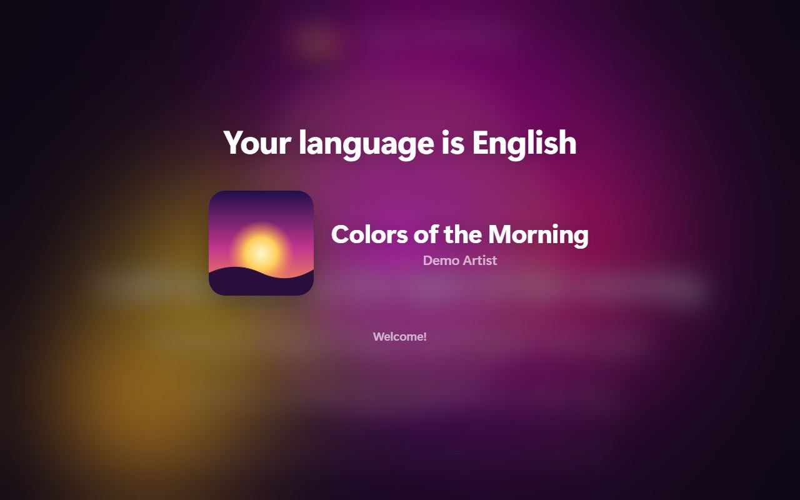
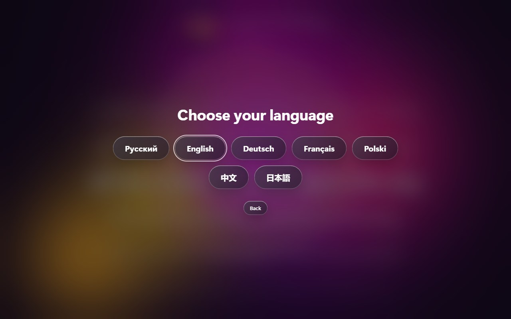
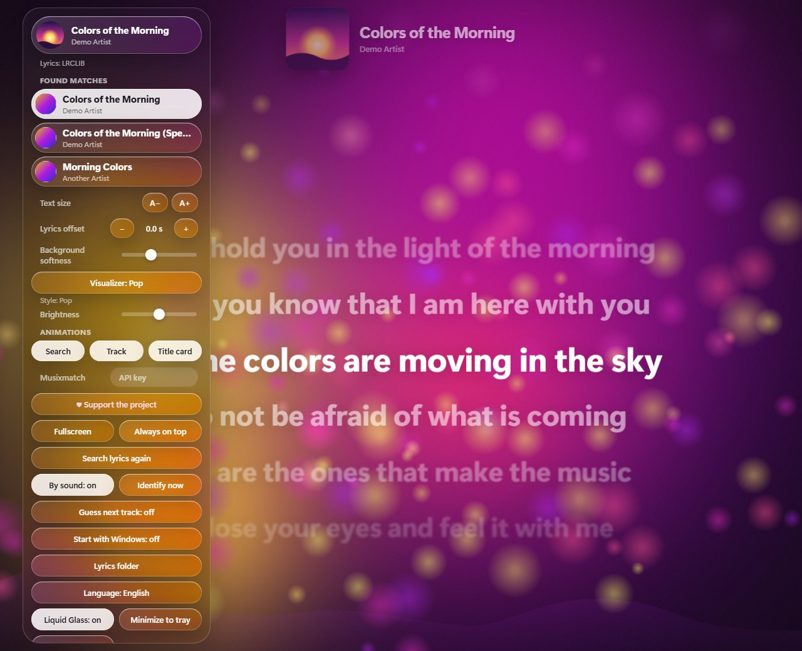

# AutoLyrics

[English](README.md) · **Русский**

Мягкое цветное окно для Windows, которое само подхватывает музыку на ПК, показывает
синхронизированный текст песни и рисует визуализатор под жанр. Интерфейс скрыт — всё
(меню и настройки) открывается правым кликом мыши.

<p align="center">
  
</p>

> Скриншоты сняты во встроенном демо-режиме на примерах (выдуманные тексты и обложка), поэтому
> настоящие тексты песен на них не показаны.

Языки интерфейса: Русский, English, Deutsch, Français, Polski, 中文, 日本語.

## Возможности

- **Сама находит трек.** Берёт данные плеера (Яндекс Музыка, Spotify, Chrome/Edge, VLC…), а если плеер
  их не сообщает — **слушает звук на ПК** и определяет песню по отпечатку.
- **Синхронные тексты** из нескольких источников; сохраняются локально как обычные `.lrc`, можно класть свои.
- **Визуализатор под жанр:** семь стилей с плавным переключением, цвета берутся из обложки альбома.
- **Мягкий анимированный интерфейс:** поиск → найденный трек → текст, необязательные кнопки
  *Liquid Glass*, значок в трее, автозапуск.
- **Семь языков:** при первом запуске язык определяется по любимой песне пользователя.

<table>
  <tr>
    <td></td>
    <td></td>
    <td></td>
  </tr>
  <tr>
    <td align="center">Электроника</td>
    <td align="center">Хип-хоп</td>
    <td align="center">Рок</td>
  </tr>
</table>

Есть также поп (пузыри), спокойный (северное сияние), классика/джаз (тонкие плавные линии) и мягкие блобы.

## Установка

1. Скачайте `AutoLyrics_<версия>_x64-setup.exe` со страницы [Releases](../../releases).
2. Запустите. Установка — для текущего пользователя, права администратора не нужны; язык
   установщика можно выбрать.
3. **Установщик не подписан цифровой подписью**, поэтому Windows SmartScreen может показать
   «Неизвестный издатель»: нажмите «Подробнее» → «Всё равно запустить». Сверить файл можно по
   SHA-256 из описания релиза.

Требования: Windows 10 (1809+) или 11 и WebView2 (в Windows 11 уже есть). Только Windows.

## Первый запуск

<table>
  <tr>
    <td></td>
    <td></td>
    <td></td>
  </tr>
</table>

Приветствие по кругу на всех семи языках просит включить любимую песню на родном языке. Программа
находит песню, ищет её текст и **определяет язык по тексту**. Внизу есть кнопка, чтобы выбрать язык
вручную. Язык можно сменить в любой момент в меню.

## Как это работает

- **Трек.** Если плеер сообщает трек системе, берём его оттуда. Если нет — программа слушает звук, который
  играет на ПК, и определяет песню по отпечатку (алгоритм Shazam); смещение внутри трека даёт синхронизацию
  текста. Так работает и веб-плеер в Яндекс Браузере, который сам трек системе не сообщает.
- **Текст.** LRCLIB, NetEase, QQ Music и KuGou (с синхронизацией по строкам) и lyrics.ovh (обычный текст)
  опрашиваются параллельно, результат берётся по приоритету. Найденное сохраняется в папку `lyrics` рядом
  с программой как обычные `.lrc` — туда же можно положить свой файл `Артист - Название.lrc`: он всегда в
  приоритете и никогда не перезаписывается. Необязательно: ключ официального API Musixmatch (на бесплатном
  тарифе даёт неполный текст без синхронизации).
- **Визуализатор.** Спектр, удары и темп считаются из звука. Стиль выбирается по жанру (из Shazam или
  iTunes), а если жанр неизвестен — оценивается по самому звуку. При поиске трека визуализатор сглажен и
  размыт, как фон.
- **Конец трека.** Когда песня доиграла, программа сразу определяет следующую (важно для переходов без
  паузы). Необязательно: «заготовка» следующего трека альбома (по умолчанию выключена — на несколько
  секунд может показать не ту песню).

## Управление

| Действие | Как |
|---|---|
| Меню и все настройки | правая кнопка мыши |
| Перетащить окно | левая кнопка мыши |
| Полный экран | двойной клик |
| Свернуть в трей / вернуть | пункт «В трей» / клик по значку в трее |
| Закрыть | пункт «Закрыть» в меню или «Выйти» в меню трея |

<p align="center">
  
</p>

## Если что-то не работает

- **Текст не найден.** Для редких песен его может не быть ни в одном источнике. Положите свой `.lrc` в
  папку `lyrics` (кнопка «Папка с текстами» в меню) — он подхватится сразу.
- **Песня не определяется.** Нужен звук на ПК и интернет. Музыка из защищённых (DRM) источников может
  записываться как тишина. Кнопка «Определить сейчас» повторяет попытку.
- **Антивирус или SmartScreen ругаются.** Программа не подписана и записывает системный звук (WASAPI
  loopback) — это ожидаемо для такого приложения; исходный код открыт.

## Конфиденциальность

Телеметрии и учётных записей нет. Настройки хранятся только на вашем компьютере. Наружу уходит:

| Что | Куда |
|---|---|
| Название и артист (поиск текста, жанра, альбома) | LRCLIB, NetEase, QQ Music, KuGou, lyrics.ovh, iTunes |
| Отпечаток звука — несколько секунд числовых данных, **не сама запись** | Shazam |
| Обложки — по ссылкам из ответов сервисов | сервера обложек |
| Название и артист + ваш ключ (только если вы его указали) | Musixmatch (официальный API) |

Сама запись звука не сохраняется и не отправляется.

## Важное о правах и сервисах

- **Тексты песен принадлежат их правообладателям.** Программа не содержит текстов и не распространяет
  их: она получает текст от сторонних сервисов и показывает его локально для личного использования.
  Сохранённые `.lrc` лежат у вас на диске — не публикуйте их.
- **Сторонние сервисы используются без договоров с ними.** Часть из них (Shazam, NetEase, QQ Music, KuGou)
  вызывается по неофициальным интерфейсам: они могут измениться, ограничить запросы или перестать
  работать, а их условия использования действуют независимо от лицензии кода. Используйте на свой риск.
  Musixmatch — только через официальный API и ваш личный ключ.
- **Проект не связан и не одобрен** Shazam/Apple, Яндексом, Spotify, Musixmatch, Valve и другими упомянутыми
  компаниями; все названия принадлежат их владельцам.

## Поддержать проект

Программа бесплатна и останется бесплатной. После суток работы в меню появляется кнопка
«♥ Поддержать проект» со ссылкой на обмен Steam. **Пожертвование добровольное и ничего не даёт
взамен.** Кнопку можно скрыть насовсем («Не показывать больше»).

## Лицензия

[GPL-3.0-or-later](LICENSE). Программа использует библиотеку [songrec](https://github.com/marin-m/SongRec)
(GPL-3.0+) для расчёта отпечатка звука, поэтому и сама распространяется на условиях GPL: получатель
установщика вправе получить исходный код (он здесь), менять его и распространять дальше на тех же условиях.
Остальные зависимости — под разрешающими лицензиями (MIT, Apache-2.0 и подобные).

**Благодарности:** [SongRec](https://github.com/marin-m/SongRec) (отпечаток звука),
[LRCLIB](https://lrclib.net) (открытая база синхронизированных текстов), [Tauri](https://tauri.app),
[cpal](https://github.com/RustAudio/cpal), [RustFFT](https://github.com/ejmahler/RustFFT),
[reqwest](https://github.com/seanmonstar/reqwest), [tokio](https://tokio.rs).

## Сборка из исходников

Нужны Rust (MSVC-тулчейн, Visual Studio Build Tools) и WebView2. Node.js не нужен — интерфейс написан на
чистом JavaScript без сборщика.

```powershell
cd src-tauri
cargo run                 # запуск в режиме разработки
cargo test                # тесты
cargo install tauri-cli --version "^2" --locked
cargo tauri build --bundles nsis   # release-сборка и установщик
```

Отладка: переменная `AUTOLYRICS_DEBUG=1` печатает работу распознавания и поиска текстов.
Интерфейс можно посмотреть и в обычном браузере (демо-режим): отдайте папку `src` любым статическим
сервером и используйте параметры `?viz=rock`, `?lang=de`, `?ob=1`, `?lyrics=de`, `?menu=1`, `?picker=1`,
`?donate=1`.

## Структура

```
src/                 интерфейс (HTML/CSS/JS): фон, визуализатор, заставка, меню, i18n
src-tauri/src/       Rust: media_watcher (SMTC), audio_capture (WASAPI loopback), analyzer (FFT),
                     recognizer (Shazam), lyrics/ (источники, .lrc-папка), genre, album, predict, shell
docs/screenshots/    скриншоты для README (сняты в демо-режиме)
PLAN.md              план и статус этапов
```
